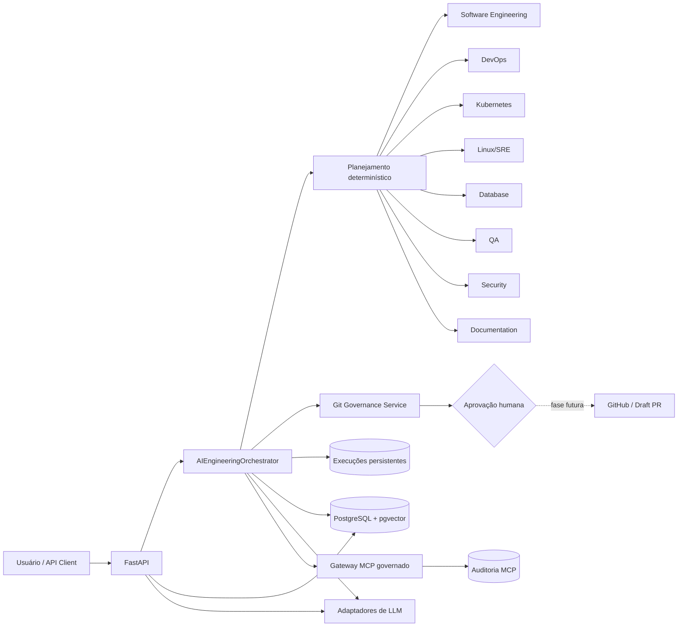

# AI Engineering Orchestrator

[](https://github.com/AriRoberto/ai-engineering-orchestrator/actions/workflows/ci.yml)
[](https://www.python.org/)
[](https://fastapi.tiangolo.com/)
[](LICENSE)

> Fundação segura e extensível para coordenar agentes especializados em engenharia de software.

Versão candidata atual: **0.2.0**. Consulte a
[documentação oficial](docs/pt-BR/documentacao-oficial.md) e o
[checklist de release](docs/pt-BR/release-0.2.0.md).

O AI Engineering Orchestrator transforma solicitações técnicas em planos auditáveis, seleciona
especialistas e consolida diagnósticos sob políticas de menor privilégio e aprovação humana. A
Fase 1 entregou o backend e o modo demo. A Fase 2 já incorporou conhecimento persistente, RAG,
contrato de LLM, memória de execuções e um gateway MCP governado. A Fase 3 adicionou quatro agentes,
a Fase 4 integrou evidências governadas e a Fase 5 iniciou a observabilidade distribuída.

## Proposta de valor

- Um ponto de entrada para análises de software, CI/CD, Kubernetes e operações Linux/SRE.
- Execuções rastreáveis por UUID, estado e linha do tempo de eventos.
- Governança Git aplicada em código, além de políticas documentadas.
- Arquitetura desacoplada de LLM, pronta para adaptadores e recuperação de conhecimento.
- Demo reproduzível sem credenciais, serviços corporativos ou APIs pagas.

## Status

| Capacidade | Estado |
|---|---|
| FastAPI, health check e OpenAPI | Implementado |
| Orquestrador determinístico e oito agentes | Implementado |
| Modo demo e ferramentas simuladas | Implementado |
| Governança Git e aprovação para escrita | Implementado |
| PostgreSQL, pgvector, ingestão e busca híbrida | Implementado na fundação da Fase 2 |
| Contrato LLM e adaptador OpenAI Agents SDK | Implementado e opcional — simulado é o padrão seguro |
| RAG integrado ao fluxo do orquestrador | Implementado com embeddings de demonstração |
| Memória persistente de execuções | Implementado com PostgreSQL |
| MCP com ferramentas governadas | Implementado com servidor simulado e auditoria |
| Database, QA, Security e Documentation Agents | Implementado — primeiro incremento da Fase 3 |
| Evidências reais do piloto público | Implementado — conteúdo controlado e contexto citado |
| Avaliação adversarial de evidências | Implementado — corpus inicial com limiar de 100% |
| Piloto privado autenticado | Validado contra `app-ams` com credencial temporária somente leitura |
| OpenTelemetry e correlação HTTP | Implementado — primeiro incremento da Fase 5 |
| Métricas e coletor Prometheus | Implementado — segundo incremento da Fase 5 |
| Dashboard Grafana e alertas Prometheus | Implementado — terceiro incremento da Fase 5 |
| Autenticação, autorização e quotas da API | Implementado — quarto incremento da Fase 5 |
| Interface React operacional | Implementado — quinto incremento da Fase 5 |
| Implantação Kubernetes | Base segura e overlay kind validados em cluster local |
| SLOs e resposta a incidentes | Implementados localmente; calibração em homologação pendente |

## Arquitetura



O domínio define contratos e estados; a aplicação coordena casos de uso; adaptadores de
infraestrutura ficam nas bordas. O LLM futuro poderá sugerir decisões, mas nunca conceder
permissões. A decisão de orquestração está no [ADR-001](docs/architecture/ADR-001-orchestration-framework.md).

## Agentes disponíveis

- **Software Engineering:** detecta stacks por manifestos e prepara diagnósticos de código.
- **DevOps:** avalia evidências de Git, CI/CD, containers e releases.
- **Kubernetes:** identifica evidências de manifests e Helm.
- **Linux/SRE:** produz diagnóstico baseado em evidências, sem comandos arbitrários no host.
- **Database:** identifica schemas, SQL e migrações versionadas.
- **QA:** correlaciona arquivos de teste e automação de CI.
- **Security:** identifica controles, nomes sensíveis, redactions e conteúdos em quarentena.
- **Documentation:** inventaria Markdown, verifica documentos essenciais e contabiliza texto seguro.

Todos implementam um contrato comum e retornam resultado estruturado. No modo demo, cada resultado
é marcado com `simulated: true`.

## Estados e limites

`PENDING → PLANNING → RUNNING → COMPLETED`, com caminhos explícitos para `WAITING_APPROVAL`,
`FAILED` e `CANCELLED`. A fundação inclui limite de passos, timeout por agente, retry limitado e
persistência integral das execuções no PostgreSQL. O uso de tokens é estimado; custo oficial ainda
depende dos dados reportados pelo provedor e de uma tabela de preços validada.

## Segurança e governança Git

O padrão é somente leitura. Solicitações de escrita param em `WAITING_APPROVAL`. O serviço de
governança bloqueia tecnicamente escrita em `main`, `master` e `develop`, merge automático e force
push, e valida branches no formato:

```text
agents/<agente>/<tipo>-<descricao>-<id>
```

O container executa sem root, remove capabilities, usa filesystem somente leitura e não recebe
tokens. Consulte [SECURITY.md](SECURITY.md). Proteções remotas de branch complementam, mas não
substituem, essas regras.

## Pré-requisitos

- Docker 24+ e Docker Compose v2; ou
- Python 3.12+ para execução local.

## Instalação e execução

### Docker Compose

```bash
cp .env.example .env
docker compose up --build
curl http://localhost:8000/health
```

### Python local

```bash
python3.12 -m venv .venv
source .venv/bin/activate
python -m pip install -e '.[dev]'
uvicorn apps.api.main:app --reload
```

A documentação OpenAPI fica em `http://localhost:8000/docs`.

Guias da Fase 1:

- [Auditoria e inventário](docs/pt-BR/auditoria-fase1.md)
- [Guia de arquitetura](docs/pt-BR/guia-arquitetura.md)
- [Primeiros passos no macOS Apple Silicon](docs/pt-BR/primeiros-passos.md)
- [Laboratório guiado](docs/pt-BR/laboratorio-fase1.md)
- [Laboratório prático da Fase 2](docs/pt-BR/laboratorio-fase2.md)

Fundação da Fase 2:

- [Inteligência e conhecimento](docs/pt-BR/fase-2-fundacao.md)

Especialização da Fase 3:

- [Agentes especializados](docs/pt-BR/fase-3-especializacao.md)
- [Laboratório prático da Fase 3](docs/pt-BR/laboratorio-fase3.md)

Piloto público da Fase 4:

- [Plano oficial de implementação](docs/pt-BR/plano-de-implementacao.md)
- [Coleta governada de evidências](docs/pt-BR/fase-4-piloto-publico.md)
- [Roteiro de validação do app-financas](docs/pt-BR/roteiro-validacao-app-financas.md)
- [Laboratório prático da Fase 4](docs/pt-BR/laboratorio-fase4.md)
- [Avaliação adversarial da Fase 4](docs/pt-BR/avaliacao-adversarial-fase4.md)
- [Laboratório privado somente leitura](docs/pt-BR/laboratorio-fase4-privado.md)

Produto e operação da Fase 5:

- [Observabilidade e próximos incrementos](docs/pt-BR/fase-5-produto-operacao.md)

O laboratório de observabilidade inicia Prometheus e Grafana:

```bash
make lab-fase5-observabilidade
```

O laboratório de acesso valida autenticação, papéis, projetos e quotas com segredos efêmeros:

```bash
make lab-fase5-acesso
```

Com a aplicação em execução, a interface fica em `http://localhost:8000/ui/`.

## Exemplo de uso

```bash
curl -X POST http://localhost:8000/v1/executions \
  -H 'Content-Type: application/json' \
  -d '{
    "project_id": "demo-project",
    "prompt": "Analise o código, Docker e Kubernetes",
    "demo": true,
    "context": {"files": ["pyproject.toml", "Dockerfile", "k8s/deployment.yaml"]}
  }'
```

Endpoints atuais:

- `GET /health`
- `GET /metrics`
- `GET /v1/agents`
- `POST /v1/executions`
- `GET /v1/executions?project_id=...`
- `GET /v1/executions/{id}?project_id=...`
- `POST /v1/executions/{id}/cancel?project_id=...`
- `POST /v1/knowledge/documents`
- `POST /v1/knowledge/search`
- `DELETE /v1/knowledge/documents/{id}`
- `POST /v1/feedback`
- `POST /v1/llm/generate`
- `GET /v1/mcp/tools?project_id=...`
- `POST /v1/mcp/invocations`
- `GET /v1/mcp/invocations?project_id=...`
- `POST /v1/evidence/executions`
- `GET /v1/evidence/audits?project_id=...`

## Adicionar projetos e agentes

Projetos recebem configuração própria em `configs/projects/`, namespace de conhecimento exclusivo,
credenciais externas separadas e política inicialmente somente leitura. Novos agentes implementam
`EngineeringAgent`, declaram um `AgentKind` e são registrados por composição em `default_agents()`.

## LLM, MCP e Agentic RAG

A fundação da Fase 2 inclui um contrato configurável de LLM, provedor simulado e integração opcional
com o OpenAI Agents SDK via Responses API. A integração real recebe a chave por Docker secret, limita
tokens e tempo, desativa armazenamento e tracing por padrão e registra o consumo retornado pelo SDK.
O modo simulado permanece como padrão para impedir custo acidental. As execuções e suas linhas do
tempo são persistidas no PostgreSQL. Conversão oficial de tokens em custo continua pendente. O gateway MCP aplica allowlists, schemas,
aprovação e escopos por projeto; o transporte real permanece desacoplado e o laboratório usa um
servidor simulado sem efeitos externos. O aprendizado ocorre por memória
persistente e feedback validado — não por alegação de retreinamento automático.

Para executar a demonstração com um modelo real, grave apenas a chave no arquivo, restrinja sua
permissão e informe um modelo disponível na conta:

```bash
mkdir -p "$HOME/.config/aieo"
read -rsp 'Chave OpenAI: ' AIEO_KEY_INPUT; printf '\n'
printf '%s' "$AIEO_KEY_INPUT" > "$HOME/.config/aieo/openai-api-key"
unset AIEO_KEY_INPUT
chmod 600 "$HOME/.config/aieo/openai-api-key"
make demo-openai \
  OPENAI_KEY_FILE="$HOME/.config/aieo/openai-api-key" \
  MODEL="gpt-5.6-luna" \
  REPOSITORY="AriRoberto/app-financas"
```

A chave não entra na imagem nem no repositório. O comando falha se o arquivo estiver ausente, com
permissão ampla ou sem modelo explícito. Use `make demo` para continuar sem chamada externa.

## Testes e qualidade

```bash
python -m pip install -e '.[dev]'
ruff check .
pytest
docker build -t ai-engineering-orchestrator:local .
```

A CI repete lint, testes e build do container em pushes e pull requests para `main` e `develop`.

Os laboratórios estão consolidados em um gate de regressão com escopos progressivos:

```bash
make regressao-static  # manifests e artefatos estruturados
make regressao         # integrações locais sem credenciais privadas
make regressao-full    # piloto privado e cluster kind, explicitamente habilitados
```

Consulte o [guia do gate de regressão](docs/pt-BR/gate-regressao.md) para requisitos, segurança e
comportamento de limpeza.

O perfil de homologação em `k8s/overlays/staging` cobre registry por digest, PVC, Ingress/TLS e
External Secrets. Valide-o com `make lab-homologacao` e consulte o
[runbook de homologação](docs/pt-BR/homologacao-kubernetes.md) antes de preparar um cluster externo.
O workflow `publish-image.yml` publica a imagem multi-arquitetura no GHCR com SBOM e proveniência;
o script `renderizar-homologacao.py` injeta valores reais e executa o preflight sem modificar os
templates versionados.
O laboratório de observabilidade inclui Alertmanager, roteamento por severidade e uma entrega
sintética ponta a ponta. Para um destino real, monte o arquivo indicado por
`AIEO_NOTIFICATION_WEBHOOK_FILE`; a URL não é armazenada no Git.

Para uma demonstração local completa do piloto público:

```bash
make demo
```

O comando sobe uma stack isolada, analisa `AriRoberto/app-financas`, valida proveniência e deixa a
UI com um relatório técnico copiável e imprimível. Outro repositório público pode ser usado com
`make demo REPOSITORY=OWNER/REPOSITORY`.
Para um repositório privado, `make demo-private REPOSITORY=OWNER/REPO TOKEN_FILE=/caminho/token`
monta uma credencial fine-grained somente leitura, força coleta apenas de metadados e mantém o
escopo restrito ao repositório informado.

## Projetos pilotos

- `AriRoberto/app-financas`: público, com inventário e conteúdo textual controlado somente leitura.
- `AriRoberto/app-ams`: privado; coleta autenticada somente leitura validada com credencial
  temporária, exigida somente durante novas execuções do laboratório.

Nenhum piloto é modificado na Fase 1.

## Roteiro de evolução

O detalhamento oficial, critérios de conclusão e ordem dos incrementos estão no
[Plano de implementação](docs/pt-BR/plano-de-implementacao.md).

1. **Fundação:** backend, orquestrador determinístico, quatro agentes, governança, testes e Docker.
2. **Inteligência e RAG:** fundação, RAG, memória persistente e governança MCP implementados; custos
   oficiais, embeddings de produção e transportes MCP reais permanecem em evolução.
3. **Especialização:** agentes de Banco de Dados, QA, Segurança e Documentação implementados e
   integrados aos estados das evidências coletadas.
4. **Pilotos:** inventário, conteúdo controlado, contexto citado, corpus adversarial e acesso
   autenticado somente leitura ao piloto privado concluídos.
5. **Produto:** correlação, métricas, interface React, Kubernetes, SLOs e runbooks implementados;
   identidade federada, documentação consolidada e release seguem incrementalmente.

## Contribuição, licença e contato

Veja [CONTRIBUTING.md](CONTRIBUTING.md). O projeto usa a [licença MIT](LICENSE). Para serviços
profissionais, propostas ou colaboração, use os canais públicos do perfil GitHub
[AriRoberto](https://github.com/AriRoberto); nenhum cliente ou resultado comercial é alegado aqui.
