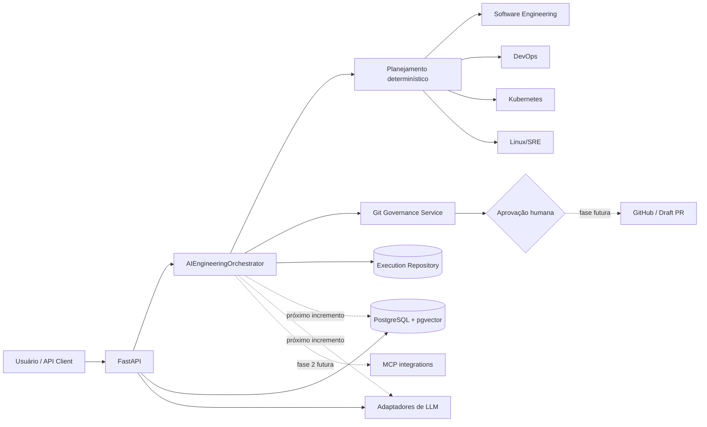

# AI Engineering Orchestrator

[](https://github.com/AriRoberto/ai-engineering-orchestrator/actions/workflows/ci.yml)
[](https://www.python.org/)
[](https://fastapi.tiangolo.com/)
[](LICENSE)

> Fundação segura e extensível para coordenar agentes especializados em engenharia de software.

O AI Engineering Orchestrator transforma solicitações técnicas em planos auditáveis, seleciona
especialistas e consolida diagnósticos sob políticas de menor privilégio e aprovação humana. A
Fase 1 entrega um backend funcional e um modo demo gratuito. A primeira entrega incremental da
Fase 2 adiciona persistência de conhecimento e um contrato de LLM; recursos ainda futuros aparecem
claramente no roadmap e não são apresentados como prontos.

## Proposta de valor

- Um ponto de entrada para análises de software, CI/CD, Kubernetes e operações Linux/SRE.
- Execuções rastreáveis por UUID, estado e linha do tempo de eventos.
- Governança Git aplicada em código, além de políticas documentadas.
- Arquitetura desacoplada de LLM, pronta para adaptadores e recuperação de conhecimento.
- Demo reproduzível sem credenciais, serviços corporativos ou APIs pagas.

## Status

| Capacidade | Estado |
|---|---|
| FastAPI, health check e OpenAPI | Implementado |
| Orquestrador determinístico e quatro agentes | Implementado |
| Modo demo e ferramentas simuladas | Implementado |
| Governança Git e aprovação para escrita | Implementado |
| PostgreSQL, pgvector, ingestão e busca híbrida | Parcial — fundação da Fase 2 implementada |
| Contrato LLM e adaptador OpenAI Agents SDK | Parcial — provedor simulado é o padrão |
| RAG integrado ao fluxo do orquestrador | Implementado com embeddings de demonstração |
| MCP e memória persistente de execuções | Planejado — próximos incrementos da Fase 2 |
| Database, QA, Security e Documentation Agents | Planejado — Fase 3 |
| Diagnósticos reais dos pilotos | Planejado — Fase 4 |
| React UI, OpenTelemetry e Kubernetes | Planejado — Fase 5 |

## Arquitetura



O domínio define contratos e estados; a aplicação coordena casos de uso; adaptadores de
infraestrutura ficam nas bordas. O LLM futuro poderá sugerir decisões, mas nunca conceder
permissões. A decisão de orquestração está no [ADR-001](docs/architecture/ADR-001-orchestration-framework.md).

## Agentes disponíveis

- **Software Engineering:** detecta stacks por manifestos e prepara diagnósticos de código.
- **DevOps:** avalia evidências de Git, CI/CD, containers e releases.
- **Kubernetes:** identifica evidências de manifests e Helm.
- **Linux/SRE:** produz diagnóstico baseado em evidências, sem comandos arbitrários no host.

Todos implementam um contrato comum e retornam resultado estruturado. No modo demo, cada resultado
é marcado com `simulated: true`.

## Estados e limites

`PENDING → PLANNING → RUNNING → COMPLETED`, com caminhos explícitos para `WAITING_APPROVAL`,
`FAILED` e `CANCELLED`. A fundação inclui limite de passos, timeout por agente e retry limitado.
Controles de tokens/custo e persistência distribuída serão adicionados junto do adaptador LLM.

## Segurança e governança Git

O padrão é somente leitura. Solicitações de escrita param em `WAITING_APPROVAL`. O serviço de
governança bloqueia tecnicamente escrita em `main`, `master` e `develop`, merge automático e force
push, e valida branches no formato:

```text
agents/<agente>/<tipo>-<descricao>-<id>
```

O container executa sem root, remove capabilities, usa filesystem somente leitura e não recebe
tokens. Consulte [SECURITY.md](SECURITY.md). Proteções remotas de branch complementam, mas não
substituem, essas regras.

## Pré-requisitos

- Docker 24+ e Docker Compose v2; ou
- Python 3.12+ para execução local.

## Instalação e execução

### Docker Compose

```bash
cp .env.example .env
docker compose up --build
curl http://localhost:8000/health
```

### Python local

```bash
python3.12 -m venv .venv
source .venv/bin/activate
python -m pip install -e '.[dev]'
uvicorn apps.api.main:app --reload
```

A documentação OpenAPI fica em `http://localhost:8000/docs`.

Guias da Fase 1:

- [Auditoria e inventário](docs/pt-BR/auditoria-fase1.md)
- [Guia de arquitetura](docs/pt-BR/guia-arquitetura.md)
- [Primeiros passos no macOS Apple Silicon](docs/pt-BR/primeiros-passos.md)
- [Laboratório guiado](docs/pt-BR/laboratorio-fase1.md)

Fundação da Fase 2:

- [Inteligência e conhecimento](docs/pt-BR/fase-2-fundacao.md)

## Exemplo de uso

```bash
curl -X POST http://localhost:8000/v1/executions \
  -H 'Content-Type: application/json' \
  -d '{
    "project_id": "demo-project",
    "prompt": "Analise o código, Docker e Kubernetes",
    "demo": true,
    "context": {"files": ["pyproject.toml", "Dockerfile", "k8s/deployment.yaml"]}
  }'
```

Endpoints atuais:

- `GET /health`
- `GET /v1/agents`
- `POST /v1/executions`
- `GET /v1/executions`
- `GET /v1/executions/{id}`
- `POST /v1/executions/{id}/cancel`
- `POST /v1/knowledge/documents`
- `POST /v1/knowledge/search`
- `DELETE /v1/knowledge/documents/{id}`
- `POST /v1/feedback`
- `POST /v1/llm/generate`

## Adicionar projetos e agentes

Projetos recebem configuração própria em `configs/projects/`, namespace de conhecimento exclusivo,
credenciais externas separadas e política inicialmente somente leitura. Novos agentes implementam
`EngineeringAgent`, declaram um `AgentKind` e são registrados por composição em `default_agents()`.

## LLM, MCP e Agentic RAG

A fundação da Fase 2 já inclui um contrato configurável de LLM, provedor simulado, adaptador opcional
para OpenAI Agents SDK, ingestão protegida, recuperação híbrida com fontes, PostgreSQL/pgvector e
feedback persistente. Recuperação e LLM já participam do fluxo do orquestrador com limites de tokens
e uso estimado explicitamente identificado. Medição oficial de custos e persistência das execuções
continuam pendentes. MCP será integrado por
adaptadores com allowlists, schemas validados e escopos por projeto. O aprendizado ocorre por memória
persistente e feedback validado — não por alegação de retreinamento automático.

## Testes e qualidade

```bash
python -m pip install -e '.[dev]'
ruff check .
pytest
docker build -t ai-engineering-orchestrator:local .
```

A CI repete lint, testes e build do container em pushes e pull requests para `main` e `develop`.

## Projetos pilotos

- `AriRoberto/app-financas`: público, configurado para inspeção futura somente leitura.
- `AriRoberto/app-ams`: privado; exige acesso autenticado e jamais será copiado para esta base pública.

Nenhum piloto é modificado na Fase 1.

## Roadmap

1. **Fundação:** backend, orquestrador determinístico, quatro agentes, governança, testes e Docker.
2. **Inteligência e RAG:** fundação e integração ao fluxo implementadas; memória persistente, custos
   oficiais, embeddings de produção e MCP permanecem em evolução.
3. **Especialização:** agentes de Banco de Dados, QA, Segurança e Documentação.
4. **Pilotos:** diagnósticos autenticados e somente leitura; mudanças apenas após aprovação específica.
5. **Produto:** React, observabilidade, Kubernetes, documentação completa e release.

## Contribuição, licença e contato

Veja [CONTRIBUTING.md](CONTRIBUTING.md). O projeto usa a [licença MIT](LICENSE). Para serviços
profissionais, propostas ou colaboração, use os canais públicos do perfil GitHub
[AriRoberto](https://github.com/AriRoberto); nenhum cliente ou resultado comercial é alegado aqui.
