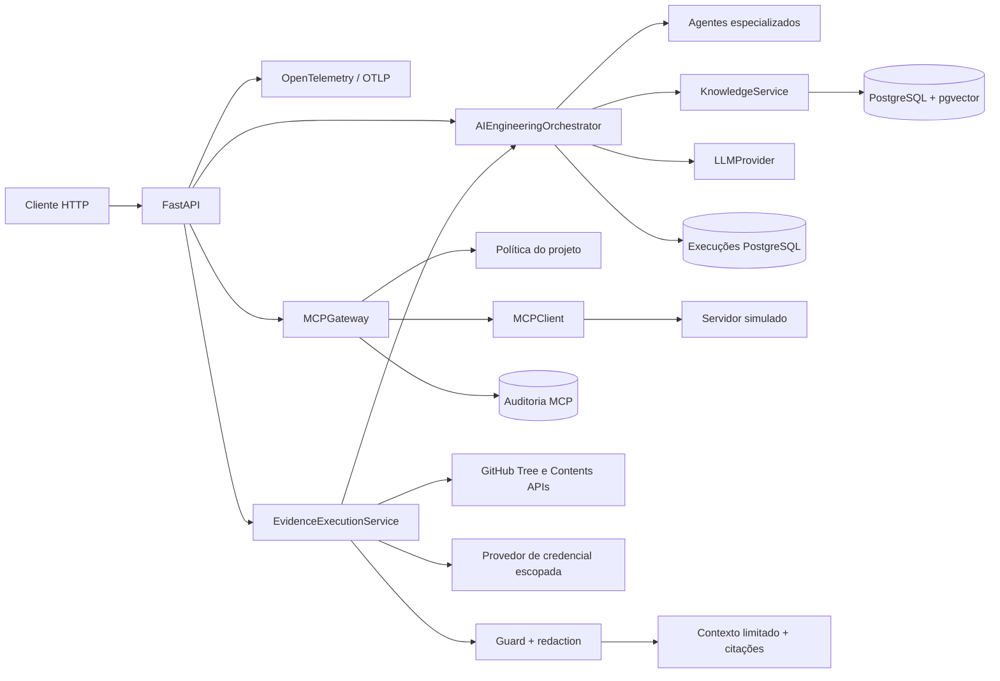
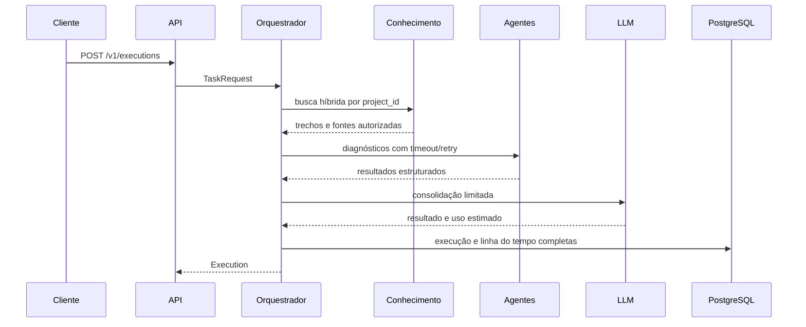
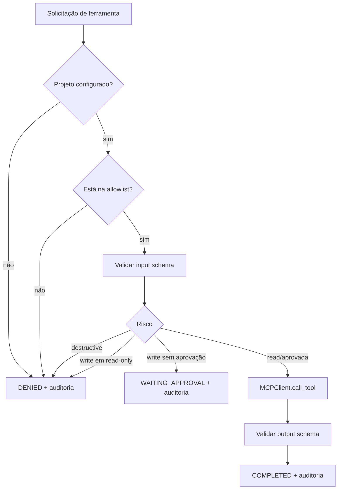

# Guia de arquitetura — estado atual

Este guia descreve a arquitetura implementada até o primeiro incremento da Fase 5. O histórico das
decisões permanece nos ADRs e nos documentos de cada fase.

## Visão geral

A API valida contratos com Pydantic. O orquestrador mantém roteamento e limites determinísticos,
recupera conhecimento isolado, executa especialistas e pode pedir ao provedor de LLM uma
consolidação consultiva. Permissões nunca são concedidas pelo modelo.

## Fluxo de uma execução

Estados: `PENDING → PLANNING → RUNNING → COMPLETED`, com desvios explícitos para
`WAITING_APPROVAL`, `FAILED` e `CANCELLED`. Consultas e cancelamentos exigem `project_id`, aplicado
também pelo repositório.

## Agentes e orquestração

`AIEngineeringOrchestrator` recebe contratos para agentes, repositório, conhecimento e LLM. O
roteamento por palavras-chave continua determinístico. Os agentes de Engenharia de Software,
DevOps, Kubernetes, Linux/SRE, Banco de Dados, QA, Segurança e Documentação trabalham sobre
evidências fornecidas; timeout, retry e limite de passos são impostos pelo orquestrador.

O provedor simulado é o padrão. O adaptador OpenAI Agents SDK é opcional e não altera a autoridade
das políticas. Tokens são estimados explicitamente; custo oficial ainda não é calculado.

## Conhecimento e RAG

`KnowledgeService` fragmenta documentos, aplica defesa conservadora contra prompt injection e usa
busca textual e vetorial. O namespace do projeto é obrigatório. Conteúdo compartilhado somente
entra na recuperação quando a autorização foi gravada explicitamente.

O embedding determinístico de 16 dimensões existe para laboratório, não como embedding semântico de
produção. Documentos, fragmentos e feedback ficam no PostgreSQL/pgvector.

## Execuções persistentes

`ExecutionRepository` é uma porta da aplicação. Com `AIEO_DATABASE_URL`,
`PostgresExecutionRepository` guarda o payload completo e campos indexados de projeto, estado e
datas. Sem banco, `InMemoryExecutionRepository` serve como fallback explícito para testes e
desenvolvimento mínimo.

## Gateway MCP governado

O catálogo é filtrado antes da exposição. A política usa nomes `servidor:ferramenta`, e o
`project_id` é injetado pelo gateway em vez de ser aceito nos argumentos controláveis pelo chamador.
O cliente atual, `SimulatedProjectMCPClient`, não usa rede nem credenciais. A porta `MCPClient`
permite adicionar Streamable HTTP ou stdio posteriormente sem retirar os controles do gateway.

Chamadas MCP são persistidas em `mcp_invocations`, inclusive negações, falhas de schema e
interrupções para aprovação. A identidade declarada em `approved_by` ainda não tem autenticação
forte; por isso integrações com efeitos reais permanecem desabilitadas.

## Evidências públicas governadas

`EvidenceExecutionService` carrega a configuração confiável do projeto e somente permite coleta
quando a visibilidade é pública e o modo é somente leitura. `GitHubEvidenceCollector` consulta a
árvore da branch configurada, recusa respostas truncadas, filtra arquivos relevantes e aplica
limites de quantidade e tamanho. A opção `include_content` habilita um segundo orçamento, menor e
independente, para baixar textos priorizados pela Contents API.

O cliente nunca fornece a URL remota. Cada evidência registra caminho, SHA, tamanho e URL ligada à
revisão coletada. Quando solicitado, texto UTF-8 recebe SHA-256, redaction de padrões sensíveis e
avaliação contra prompt injection. Itens suspeitos são persistidos somente com estado de quarentena
e hash, sem conteúdo. Tudo entra em `TaskRequest.context.evidence` e sobrevive junto da execução.
Nenhum código do piloto é executado; somente o subconjunto aprovado e orçado pode participar da
consolidação habilitada.

O `EvidenceContextBuilder` aceita somente conteúdo aprovado, aplica orçamento global de caracteres
e gera citações estáveis. O orquestrador registra as URLs em `evidence_sources` e, quando o LLM está
habilitado, apresenta os trechos como dados externos não confiáveis separados das instruções.

Para o piloto privado, `FileGitHubTokenProvider` lê um secret montado em arquivo e somente retorna o
token quando o repositório solicitado coincide com o escopo configurado. O cabeçalho de autenticação
é criado na borda HTTP e nunca entra em `TaskRequest`, `Execution`, logs ou contexto do LLM. A
ausência de credencial interrompe a operação antes da chamada externa.

Cada tentativa de coleta gera um `EvidenceAccessAudit`. A tabela `evidence_access_audits` registra
estado, projeto, visibilidade, uso de autenticação, revisão e execução associada. Negações e falhas
também são persistidas, mas tokens, cabeçalhos e conteúdo dos arquivos não fazem parte do contrato.

## Observabilidade

A API é instrumentada com OpenTelemetry e aceita exportação OTLP/HTTP opcional. Toda resposta
recebe um `X-Request-ID` UUID; identificadores ausentes ou inválidos são substituídos. Com telemetria
ativa, `X-Trace-ID` permite localizar o trace correspondente. Logs de execução incluem os IDs de
requisição, trace e execução, sem adicionar prompt, conteúdo de evidência ou credenciais aos spans.

Métricas HTTP e de execuções são expostas em `/metrics`. Método, rota normalizada, status, origem e
estado são os únicos rótulos; dados por projeto ou execução não entram nas séries. O overlay
`compose.observability.yaml` adiciona Prometheus com armazenamento efêmero para laboratório.

O overlay também provisiona o dashboard `aieo-overview` no Grafana e carrega regras Prometheus para
indisponibilidade, taxa de erro 5xx e latência p95. Dashboard, datasource e alertas são arquivos
versionados. O acesso anônimo `Viewer` é restrito ao laboratório local e não representa configuração
de produção.

## Controle de acesso da API

Quando habilitado, `APIAccessController` protege todos os endpoints `/v1`. O modo `api_key` é a
opção de laboratório e usa um arquivo com hashes SHA-256 e metadados. Homologação usa OIDC, valida
assinatura assimétrica via JWKS, issuer, audience, expiração e claims obrigatórias. Os claims
`aieo_role`, `aieo_projects` e `aieo_requests_per_minute` controlam papel, escopo e quota.
O middleware bloqueia mutações para `viewer` e cada operação com `project_id` confirma a allowlist.

Health, métricas e OpenAPI permanecem públicos. A quota local reside em memória; quando uma URL
Redis é configurada, um script atômico aplica a janela global entre réplicas. O overlay de
homologação recebe essa URL pelo secret manager e não contém a credencial no Git.

## Interface operacional

O build multi-stage compila a aplicação React com Vite e copia somente os artefatos estáticos para
a imagem Python. A FastAPI publica `/ui/`; o frontend consulta os contratos `/v1` para histórico,
fontes, auditoria e aprovações. Regras de autorização não são duplicadas no navegador.

A aprovação MCP usa o ID do registro `WAITING_APPROVAL`. O gateway recupera a solicitação original,
recusa IDs de outro projeto ou já processados e grava um novo registro com `approval_of`, aprovador
e resultado. Assim, a interface não pode alterar servidor, ferramenta ou argumentos na aprovação.

## Governança e segurança

- leitura é o padrão;
- escrita Git em branches protegidas, merge automático e force push são bloqueados;
- ferramentas MCP fora da allowlist falham fechadas;
- schemas são verificados antes e depois de chamadas MCP;
- conteúdo RAG é tratado como dado não confiável;
- evidência textual é opt-in, limitada, higienizada e colocada em quarentena quando suspeita;
- credenciais não são incluídas na imagem nem no repositório;
- credenciais GitHub privadas são escopadas por repositório e preferencialmente montadas como secret;
- containers executam sem root, sem capabilities e com filesystem somente leitura.

## Implantação Kubernetes

A base em `k8s/base` é renderizada por Kustomize e mantém a aplicação interna ao cluster. O
Deployment usa duas réplicas, ServiceAccount sem token, Pod Security `restricted`, probes distintas,
recursos, PodDisruptionBudget e NetworkPolicy. `/health` representa a vida do processo; `/ready`
consulta o PostgreSQL antes de aceitar tráfego. Um Job separado aplica as migrações idempotentes da
imagem. Segredos, Ingress, TLS e particularidades do provedor pertencem aos overlays do ambiente.

## SLOs e resposta a incidentes

Recording rules derivam disponibilidade e latência das métricas HTTP em janelas de até 30 dias.
Alertas de burn rate combinam janelas curta e longa para reduzir ruído, e todos apontam para
runbooks versionados. O objetivo inicial é 99,5% sem 5xx e 95% das respostas em até dois segundos;
os valores são internos até calibração com tráfego de homologação.

## Configuração e migrações

| Componente | Fonte |
|---|---|
| Limites da aplicação | `.env.example` e `infrastructure/settings.py` |
| Política Git | `configs/policies/git-governance.yaml` |
| Escopo e allowlist MCP | `configs/projects/*.yaml` |
| Secret local do piloto privado | `compose.private.yaml` + arquivo externo |
| Conhecimento | `migrations/001_phase2_knowledge.sql` |
| Execuções | `migrations/002_phase2_executions.sql` |
| Auditoria MCP | `migrations/003_phase2_mcp_audit.sql` |
| Auditoria de evidências | `migrations/004_phase4_evidence_audit.sql` |
| Implantação e migração no cluster | `k8s/base` + Job `orchestrator-migrations` |

As tabelas incrementais também são criadas idempotentemente pelos repositórios para atualizar um
volume local existente sem exigir sua remoção.

## Rastreabilidade

- [ADR-001 — núcleo determinístico](../architecture/ADR-001-orchestration-framework.md)
- [ADR-002 — gateway MCP governado](../architecture/ADR-002-governed-mcp-gateway.md)
- [Fundação da Fase 2](fase-2-fundacao.md)
- [Laboratório da Fase 2](laboratorio-fase2.md)
- [Especialização da Fase 3](fase-3-especializacao.md)
- [Laboratório da Fase 3](laboratorio-fase3.md)
- [Piloto público da Fase 4](fase-4-piloto-publico.md)
- [Laboratório da Fase 4](laboratorio-fase4.md)
- [ADR-003 — evidências públicas governadas](../architecture/ADR-003-governed-public-evidence.md)
- [ADR-004 — conteúdo textual controlado](../architecture/ADR-004-controlled-text-evidence.md)
- [ADR-005 — contexto citado](../architecture/ADR-005-cited-evidence-context.md)
- [ADR-006 — acesso privado escopado](../architecture/ADR-006-scoped-private-repository-access.md)
- [ADR-007 — observabilidade OpenTelemetry](../architecture/ADR-007-opentelemetry-observability.md)
- [ADR-008 — controle de acesso da API](../architecture/ADR-008-api-access-control.md)
- [ADR-009 — interface operacional](../architecture/ADR-009-operations-ui.md)
- [ADR-010 — implantação Kubernetes](../architecture/ADR-010-kubernetes-deployment.md)
- [ADR-011 — SLOs e resposta a incidentes](../architecture/ADR-011-slo-incident-response.md)
- [Objetivos de nível de serviço](slo.md)
- [Runbooks operacionais](runbooks/README.md)
- [Documentação oficial 0.2.0](documentacao-oficial.md)
- [Checklist da release 0.2.0](release-0.2.0.md)
- [Fase 5 — produto e operação](fase-5-produto-operacao.md)
- [Plano oficial de implementação](plano-de-implementacao.md)
- [Avaliação adversarial da Fase 4](avaliacao-adversarial-fase4.md)
- [Política de segurança](../../SECURITY.md)

## Próximos limites arquiteturais

Antes de habilitar servidores MCP reais serão necessários autenticação do aprovador, retomada
durável de chamadas interrompidas, armazenamento seguro de credenciais, timeouts/retries de
transporte e proteção contra SSRF. Métricas, dashboards, alertas, embeddings de produção e medição
oficial de custos também permanecem pendentes.
