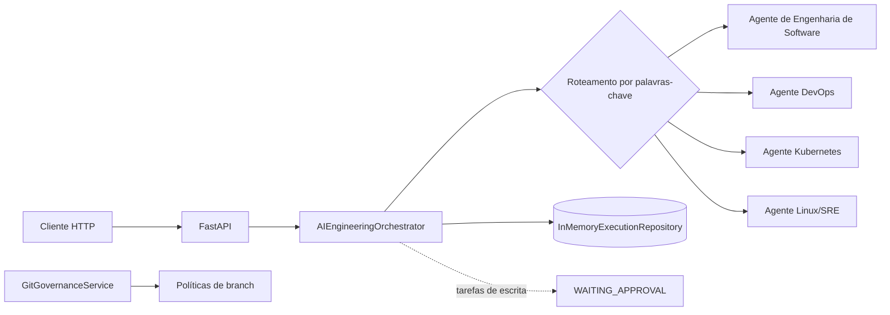
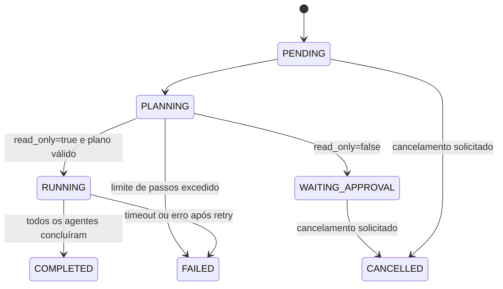
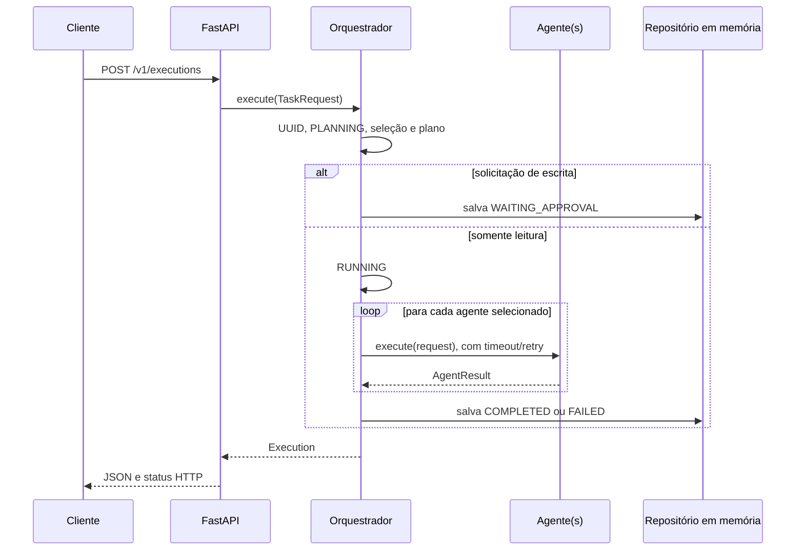
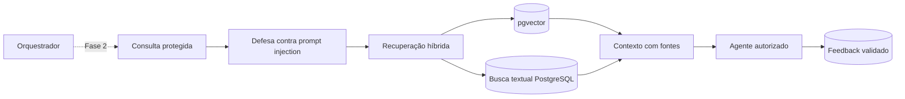

# Guia de arquitetura — Fase 1

Este guia descreve somente o que existe na Fase 1. Integrações com LLM, Agentic RAG, PostgreSQL,
pgvector, MCP e os agentes adicionais pertencem a fases futuras.

## Visão geral

A API recebe uma solicitação validada por Pydantic. O orquestrador cria uma execução com UUID,
seleciona agentes por regras determinísticas, monta um plano e chama os agentes sequencialmente.
Os resultados são guardados apenas em memória e desaparecem quando o processo reinicia.

## Como o orquestrador funciona

O componente central é `AIEngineeringOrchestrator`, em
`src/ai_engineering/orchestrator/service.py`. Ele recebe:

- um mapa de agentes que implementam `EngineeringAgent`;
- um repositório de execuções;
- o limite máximo de passos;
- o timeout individual de cada agente;
- a quantidade máxima de novas tentativas.

Cada solicitação cria uma instância de `Execution`. A execução começa em `PENDING` e registra cada
transição em `events`, com data/hora UTC e uma descrição. O estado `PENDING` é o valor inicial do
objeto; o primeiro evento persistido é `PLANNING`.

Na Fase 1 não existe endpoint de aprovação para retomar uma execução em `WAITING_APPROVAL`. Esse
estado representa uma interrupção segura, não uma automação de escrita completa.

## Como os agentes são selecionados

O método `route()` normaliza o texto com `casefold()` e procura palavras-chave:

| Agente | Palavras-chave atuais |
|---|---|
| Kubernetes | `kubernetes`, `k8s`, `helm`, `deployment` |
| DevOps | `pipeline`, `ci/cd`, `docker`, `git`, `release` |
| Linux/SRE | `linux`, `incident`, `log`, `sre`, `servidor` |
| Software Engineering | `código`, `code`, `arquitetura`, `stack`, `software`, `teste` |

Mais de um agente pode ser escolhido. Se nenhuma regra corresponder, o Agente de Engenharia de Software é
usado como fallback. Não há classificação por LLM nesta fase.

## Ciclo de execução de uma tarefa

Os agentes não executam em paralelo. Cada chamada usa um `ThreadPoolExecutor` próprio para aplicar
timeout. Erros comuns podem ser tentados novamente conforme `AIEO_MAX_RETRIES`; timeout falha
imediatamente. O detalhe interno de exceções não é devolvido ao cliente.

## Como os agentes se comunicam

Na Fase 1 os agentes **não se comunicam diretamente entre si**. Todos recebem a mesma
`TaskRequest`, devolvem um `AgentResult`, e o orquestrador agrega os resultados em ordem. Não há
mensageria, memória compartilhada entre agentes, handoffs ou colaboração dirigida por LLM.

O contrato comum fica em `src/ai_engineering/agents/base.py`. Os quatro agentes concretos ficam em
`src/ai_engineering/agents/specialists.py` e trabalham apenas sobre evidências fictícias informadas
em `context.files`; eles não leem repositórios nem executam comandos no host.

## Governança Git

`GitGovernanceService`, em `src/ai_engineering/governance/git.py`, implementa controles locais:

- bloqueia escrita em `main`, `master` e `develop`;
- exige o padrão `agents/<agente>/<tipo>-<descricao>-<id>`;
- bloqueia merge automático e force push;
- devolve `requires_human_approval=true` antes de autorizar publicação de escrita.

A política declarativa equivalente está em `configs/policies/git-governance.yaml`. Esses controles
são testados, mas ainda não estão conectados a um executor Git real. Na auditoria de 13/10/2026,
`main` e `develop` existiam no GitHub, porém a proteção remota de branches ainda não estava ativa.

## Configurações

| Local | Conteúdo |
|---|---|
| `.env.example` | Variáveis de execução e limites seguros |
| `src/ai_engineering/infrastructure/settings.py` | Leitura tipada de variáveis `AIEO_*` |
| `configs/policies/git-governance.yaml` | Política Git declarativa |
| `configs/projects/app-financas.yaml` | Metadados somente leitura do piloto público |
| `configs/projects/app-ams.yaml` | Metadados somente leitura do piloto privado |

Os YAMLs de projeto ainda não são carregados pela API. Eles preparam o isolamento futuro, mas não
constituem persistência ou autorização completa.

## Armazenamento de resultados

`InMemoryExecutionRepository` mantém execuções num dicionário protegido por `RLock`. O repositório
salva e devolve cópias profundas para reduzir mutações acidentais entre consumidores. As rotas
`GET /v1/executions` e `GET /v1/executions/{id}` consultam esse armazenamento.

Limitações: os dados não sobrevivem ao restart, não são compartilhados entre réplicas e não há
paginação. PostgreSQL e isolamento persistente por projeto ainda não foram implementados.

## Logs

`configure_logging()` configura `structlog` para JSON com nível e timestamp UTC. Atualmente a API
registra o evento `execution_processed` com ID e estado final. Logs de acesso e ciclo do servidor
são emitidos pelo Uvicorn e permanecem em formato próprio. Não há OpenTelemetry, correlação
distribuída, exportador ou armazenamento central na Fase 1.

## Integração futura do Agentic RAG

A Fase 2 deverá introduzir portas internas para ingestão e recuperação, namespaces separados por
projeto, metadados de fonte, busca semântica e textual, exclusão/reindexação e feedback humano.
Conteúdo recuperado será tratado como dado não confiável. A governança e as aprovações continuarão
fora do controle do modelo. Isso representa memória persistente e recuperação — não retreinamento
automático do modelo.

